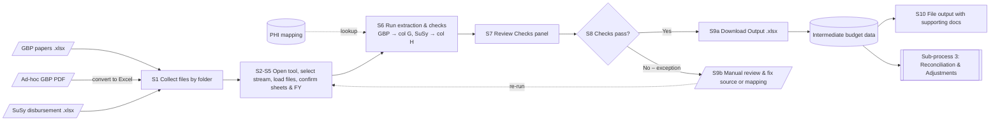

# SOP – 1. Approved Budget and Disbursement

> **Status:** Draft v0.1 (working notes). This will become the user SOP and the basis for a detailed draw.io flow of this sub-process.
> **Scope:** Sub-process 1 of *Funding Stream Budget vs PHI Reconciliation* (see `funding-process-flow(3)(2).drawio`).
> **Timing:** April (start of FY).
> **Tool:** `approved_budget_disbursement.html`

---

## 1. Purpose

For one funding stream at a time, confirm that the **approved budget** for each PHI (from the Global Budget Paper, GBP) matches the **amount set up for disbursement** (from the SuSy disbursement file). Matches go forward as intermediate budget data for sub-process 3 (Reconciliation & Adjustments). Mismatches and exceptions are reviewed and fixed manually, then the check is re-run.

## 2. Inputs

| # | Input | Format | Where it comes from | Used for |
|---|---|---|---|---|
| I1 | GBP paper(s) – one per cluster, plus any ad-hoc GBPs | `.xlsx` (ad-hoc PDFs must first be converted to Excel) | `01 Global Budget Paper/` | Approved budget per PHI (column G **Amount Approved**) |
| I2 | SuSy disbursement file – one file, one tab per cluster | `.xlsx` | `02 SuSy Disbursement File/` | Disbursement per PHI (column H **Amount Disbursed**) |
| I3 | PHI name mapping | `.xlsx` | Project root | Translates GBP and SuSy PHI names to the official PHI name |
| I4 | MAF Standalone Budget input | `.xlsx` | `01 Global Budget Paper/` | Preview only (not yet used in checks) |

### 2.1 Required file layouts

**GBP paper (I1)**
- The header row is the first row (within the top 30) whose column A is `Funding Period` – row 7 in Annex B1 papers, row 5 or 7 in PGMG papers. It must also contain `Funding Programme`.
- PHI columns are the columns between `Funding Programme` and `TOTAL` (G onwards in Annex B1, F onwards in PGMG papers); each header is a PHI name.
- The funding stream row is found by its Funding Programme text (e.g. `Output Goods & Services Tax (Output GST) Subvention`). It can be on any row.
- Exception: the PGMG paper (Annex B2) has a different layout and is **not yet supported**.

**Cluster (I1 → I2)**
- Clusters are always **NHG**, **NUHS** and **SHS**. Each GBP paper's cluster is read from its sheet name (e.g. `FY25 Subvention_NHG`), or from the file name if the sheet name has none. A paper with no cluster, or more than one, is skipped.
- The cluster picks the SuSy tab (`NHG` → `NHG_Report`) and limits the PHI mapping to that cluster's rows.

**SuSy disbursement file (I2)**
- One tab per cluster, named `<Cluster>_Report`.
- The header row is the first row (within the top 30) containing `Disbursement Number`; it must contain **exactly one** `Programme Funding` column and a `Total Approved Budget for FY` column.
- PHI columns are the columns between `Total Approved Budget for FY` and `Total`.
- Rows from the **Prior Years' Adjustments (PYAs)** marker downwards are ignored (PYAs are not current-year disbursements).
- Rows without a **Disbursement Number** (headings/summaries) are ignored.
- Each funding stream row (e.g. `Output GST Subvention`) must have **exactly one** value in the PHI columns. That column identifies the PHI; the amount is taken from `Total Approved Budget for FY`.

**PHI name mapping (I3)**
- Row 1 headers: `FY`, `Cluster`, `PHI Official Name`, `SuSy - PHI Name`, `GBP Annex B1/B2 - PHI Name`.
- Only rows for the selected FY are used (e.g. `25` = FY2025).
- `PHI Official Name` = `N.A.` (e.g. SuSy `Others`) is excluded from the reconciliation.

### 2.2 Funding streams

| Stream | GBP Funding Programme | SuSy Programme Funding | Status |
|---|---|---|---|
| Output GST | Output Goods & Services Tax (Output GST) Subvention | Output GST Subvention | Supported |
| Disallowed GST | Disallowed Input Goods & Services Tax (DiGST) Subvention | Disallowed Input GST Subvention | Supported |
| MAF | Medication Assistance Fund (MAF) | MAF (exact; not "MAF wef …" or "MAF Plus") | Supported |
| MAF Plus | Medication Assistance Fund (MAF) Plus | MAF Plus (not "PG/MG assistance for MAF Plus") | Supported |
| PG SOC – Services | Specialist Outpatient Clinic (SOC) Services | SOC Svcs | Supported (PG block, `<Cluster>_PG` tab) |
| PG SOC – Drugs | Drugs - Standard Drug List (SDL) / Medication Assistance Fund (MAF) | Drugs (SDL/MAF) | Supported – **non-polyclinic** PHIs only |
| PG Poly – Services | Polyclinic Services + Cervical Cancer Screening (CSS) + Breast Cancer Screening (BSS) (added together) | Poly Svcs + CSS + BSS | Supported |
| PG Poly – Drugs | Drugs - Standard Drug List (SDL) / Medication Assistance Fund (MAF) | Drugs (SDL/MAF) | Supported – **polyclinic** PHIs only |
| PG NAIS – SOC | National Adults Immunisation Schedule (NAIS) - Specialist Outpatient Clinic (SOC) | NAIS (SOC) | Supported |
| PG NAIS – Poly | National Adults Immunisation Schedule (NAIS) - Polyclinic | NAIS (Poly) | Supported |
| MG streams | (Annex B2 – MG block) | `<Cluster>_MG` tab | Not yet supported |

PG streams read the **Annex B2 (PGMG)** paper and only use rows inside the `Pioneer Generation (PG)` block (from that heading to the `Merdeka Generation (MG)` heading, wherever they are). One output row per PHI **per category** (`Categories` column). Polyclinic PHIs = official names containing "Polyclinic" (NHG Polyclinics, National University Polyclinics, SingHealth Polyclinics, Eunos / Tampines North / Pasir Ris Polyclinic).

---

## 3. Procedure

| Step | Who | Action | Tool / output |
|---|---|---|---|
| **S1** | Analyst | **Collect files.** Save GBP papers to `01 Global Budget Paper/` and the SuSy file to `02 SuSy Disbursement File/`. Convert any ad-hoc GBP PDFs to Excel. | Files by folder |
| **S2** | Analyst | **Open the tool** `approved_budget_disbursement.html` in Microsoft Edge or Chrome. The status bar should turn blue ("Select the GBP paper(s)…"). | – |
| **S3** | Analyst | **Select the funding stream** (e.g. Output GST). | – |
| **S4** | Analyst | **Load files.** Select the GBP paper(s), SuSy file and PHI mapping (optionally the MAF file). | – |
| **S5** | Analyst | **Confirm sheets and FY.** Check the sheet picked for each GBP (`FY25 Subvention_<Cluster>`). The SuSy tab is chosen automatically from each GBP's cluster (`<Cluster>_Report`); the SuSy field lists which cluster tabs were found. FY is auto-filled from the GBP sheet name; correct it if needed. | – |
| **S6** | Analyst | **Run extraction & checks.** | Checks panel, Output table |
| **S7** | Analyst | **Review the Checks panel.** Green = passed, amber = warning, red = error (file skipped or run stopped). | – |
| **S8** | Analyst | **Decision – Checks pass?** All output rows have `Check 1 = Y` and no Remarks. | – |
| **S9a** | Analyst | **If yes:** Download the output (`.xlsx`). This is the **intermediate budget data** for sub-process 3. | `Output - <Stream> - <timestamp>.xlsx` |
| **S9b** | Analyst / Finance | **If no:** Review each flagged row (see §4), fix the source file or mapping, then **re-run from S4**. | Corrected source files |
| **S10** | Analyst | **File the output** with its supporting documents (listed in the `Supporting Document` column). | – |

---

## 4. Checks and exceptions

The tool raises these in the **Checks** panel (file-level) or the **Remarks** column (row-level).

### 4.1 File-level checks

| Check | Result if it fails | Action |
|---|---|---|
| File is `.xlsx` and readable | File rejected | Re-save as `.xlsx` |
| GBP has a `Funding Period` row (column A, top 30 rows) that also contains `Funding Programme` | That GBP is skipped (red) | Check the sheet selection / header row |
| GBP sheet or file name identifies exactly one cluster (NHG / NUHS / SHS) | That GBP is skipped (red) | Rename the sheet or file to include the cluster |
| Funding stream found in GBP | Warning, no values from that file | Confirm the stream exists in that GBP |
| SuSy has a `<Cluster>_Report` tab for each GBP cluster | That cluster's rows get remark `SuSy tab "…" not found` (red) | Check the SuSy file / tab name |
| SuSy has a `Disbursement Number` header row with exactly one `Programme Funding`, a `Total Approved Budget for FY` and a `Total` after it | That cluster's tab is skipped (red) | Check the SuSy tab / header row |
| SuSy has a `Prior Years' Adjustments` section | Warning only – all rows used | Confirm the tab has no PYA section |
| Funding stream rows in SuSy have a Disbursement Number | Rows without one are ignored (warning with count) | Confirm they are headings/summaries |
| Mapping has the required headers and rows for the FY | Run stops (red) | Fix mapping headers / add FY rows |

### 4.2 Row-level remarks

| Remark | Meaning | Typical fix |
|---|---|---|
| `Amount mismatch (H − G = x)` | GBP and SuSy amounts differ | Confirm which is correct; correct SuSy or obtain the updated GBP |
| `Not in GBP` | SuSy has an amount, GBP has none for this PHI | Check the GBP / mapping |
| `Not in SuSy` | GBP has a budget, no SuSy disbursement row | Set up disbursement in SuSy |
| `Duplicate in GBP (not added)` | Same PHI appears more than once across GBP rows/files | Remove the duplicate paper or row; amounts are **not** summed |
| `Duplicate in SuSy (not added)` | Same SuSy PHI column used by more than one stream row | Correct the SuSy rows |
| `SuSy amounts combined: …` | Different SuSy names map to one PHI (e.g. ICH + TTSH-ICH) and were **added** | Informational – confirm the total |
| `SuSy row N has K values … PHI cannot be identified` | SuSy row has 0 or 2+ PHI values | Correct the SuSy row so only one PHI column is filled |
| `Unmapped PHI name in GBP/SuSy: "x"` | Name not in the mapping for this FY | Add the name to the PHI mapping |
| `Ambiguous PHI name …` | Name maps to more than one PHI | Fix the mapping so each name maps to one PHI |
| `Non-numeric GBP value` / `Total Approved Budget … blank` | Amount cell is not a number | Correct the source cell |

Values under SuSy `Others` (mapped to `N.A.`) are excluded and listed as a warning in the Checks panel.

---

## 5. Output

One `.xlsx` with a single sheet `Output`:

| Col | Field | Source |
|---|---|---|
| A | S/N | Sequential |
| B | Cluster | PHI mapping |
| C | PHI | PHI Official Name |
| D | FY | Selected FY |
| E | Funding Stream | Selected stream |
| F | Categories | Stream category (PG: Services / Drugs, NAIS: SOC / Poly); blank for Annex B1 streams |
| G | Amount Approved | GBP |
| H | Amount Disbursed | SuSy `Total Approved Budget for FY` |
| I | Check 1 | `Y` if G = H (rounded to whole dollars), else `N` |
| J | Supporting Document | GBP and SuSy file names |
| K | Date Timestamp | Run date/time |
| L | Amount to Adjust | Blank (TBC – sub-process 3) |
| M | Remarks | Exceptions from §4.2 |

---

## 6. Process flow (for the detailed draw.io)

Node IDs match the step numbers above so the diagram and SOP stay aligned.

Suggested swimlanes for the detailed diagram: **Analyst**, **Tool (HTML)**, **Finance / data owner** (fixes source files), with the tool lane showing the internal checks (§4.1 → extraction → mapping → §4.2 remarks).

---

## 7. Open items

- [ ] PGMG stream: decide which rows to use (PG/MG summary rows, total row, or detail lines) and add support for the Annex B2 layout.
- [ ] MAF Standalone Budget: define how it is used in the checks.
- [ ] PHI mapping: add NUHS and SHS rows; SuSy tabs for NUHS and SHS.
- [ ] Output columns `Categories` and `Amount to Adjust`: define rules.
- [ ] Roles: confirm who performs S9b fixes and who approves the output.
- [ ] Where the output and supporting documents are filed (S10).
